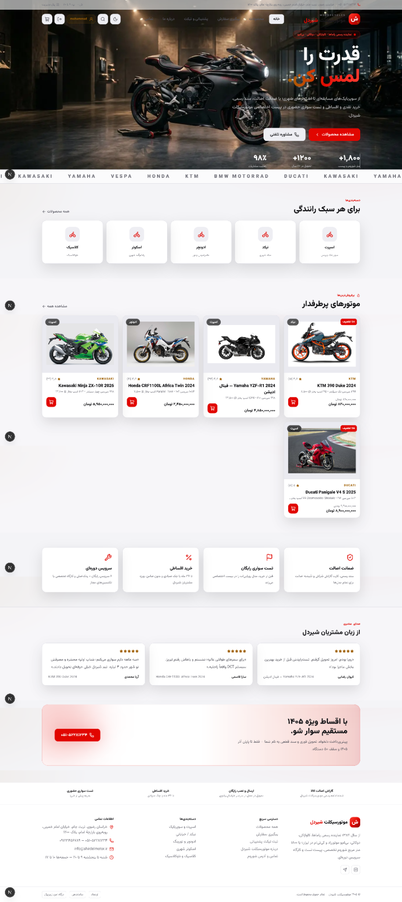
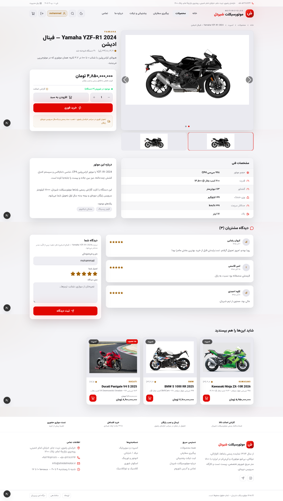
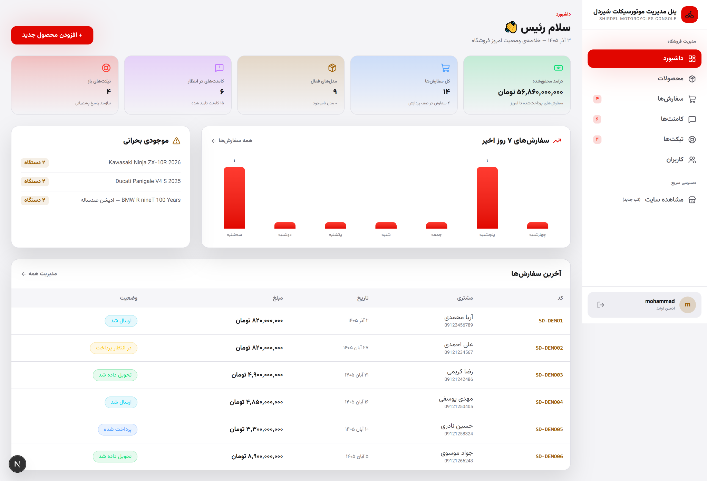
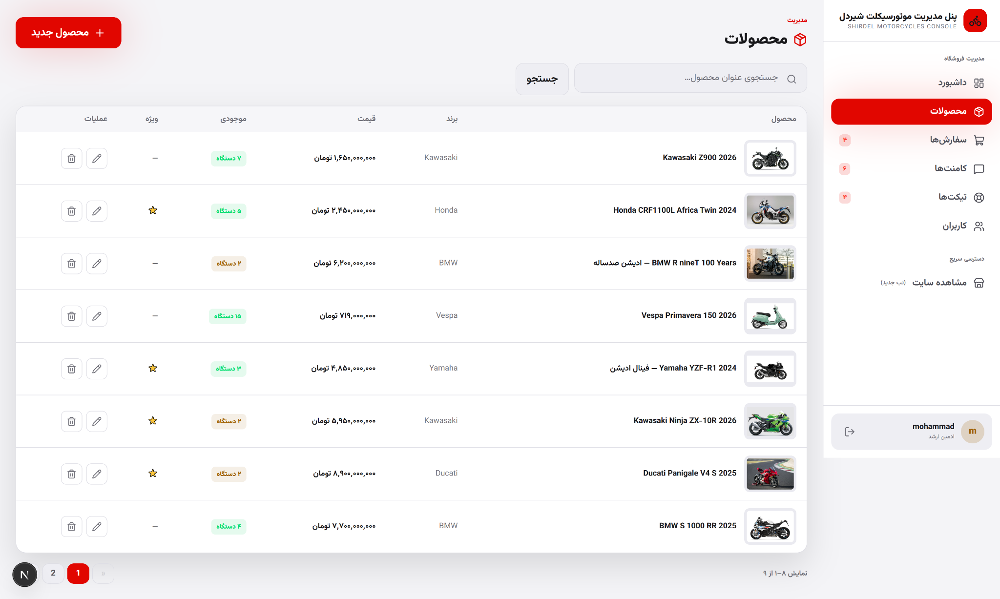
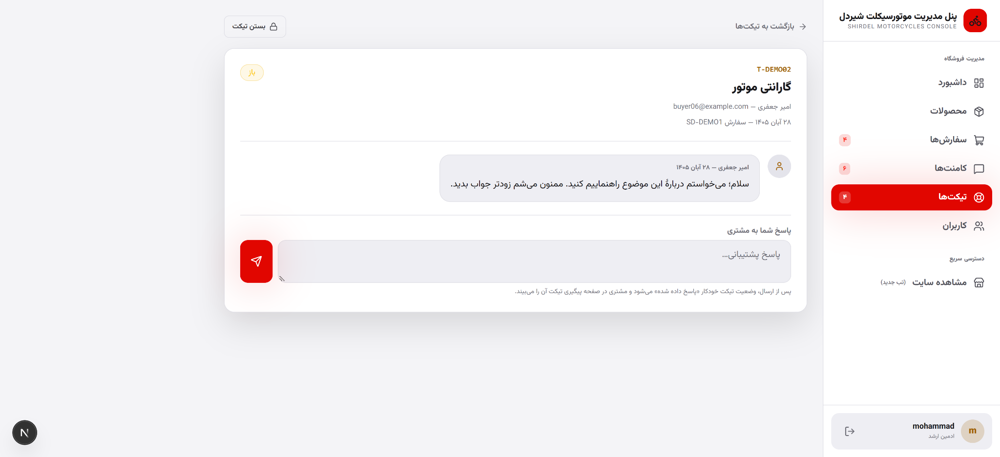

# 🏍️ Motorcycle Shirdel | موتورسیکلت شیردل

**A Persian RTL motorcycle e-commerce platform with a customer storefront and an admin dashboard.**  
**فروشگاه اینترنتی تخصصی موتورسیکلت با رابط فارسی و راست‌چین، به همراه پنل مدیریت فروشگاه.**

Built with **Next.js 16, React 19, Tailwind CSS 4, MongoDB, and Mongoose**. The project includes product browsing, shopping cart and checkout flows, order tracking, customer accounts, support tickets, and store administration.

این پروژه با **Next.js 16، React 19، Tailwind CSS 4، MongoDB و Mongoose** ساخته شده و امکاناتی مانند مشاهده محصولات، سبد خرید، ثبت سفارش، پیگیری سفارش، حساب کاربری، پشتیبانی و مدیریت فروشگاه را ارائه می‌دهد.

---

## 📸 Screenshots | تصاویر پروژه

### Storefront | صفحه اصلی فروشگاه



### Product details | جزئیات محصول



### Admin dashboard | داشبورد مدیریت



### Product management | مدیریت محصولات



### Support ticket | تیکت پشتیبانی



---

## ✨ Features | امکانات

### Storefront | فروشگاه

- Cinematic homepage with featured motorcycles, brands, categories, and product highlights.  
  صفحه اصلی با بنر تصویری، برندها، دسته‌بندی‌ها و محصولات ویژه.
- Product catalog with search, brand/category filters, and sorting.  
  کاتالوگ محصولات با جستجو، فیلتر برند و دسته‌بندی و مرتب‌سازی.
- Product detail pages with technical specifications, stock, verified reviews, and image gallery.  
  صفحه محصول با مشخصات فنی، موجودی، نظرات تأییدشده و گالری تصاویر.
- Responsive image gallery powered by Swiper (when multiple images are available).  
  گالری واکنش‌گرا با Swiper برای محصولات دارای چند تصویر.
- Persian RTL layout and light/dark themes.  
  رابط فارسی و راست‌چین به همراه پوسته روشن و تاریک.

### Cart & Orders | سبد خرید و سفارش‌ها

- Cart state persisted in `localStorage`.  
  نگهداری سبد خرید در `localStorage`.
- Checkout with simulated online payment or cash on delivery.  
  تسویه‌حساب با پرداخت آنلاین شبیه‌سازی‌شده یا پرداخت در محل.
- Order tracking using tracking code and mobile number, including status timeline.  
  پیگیری سفارش با کد رهگیری و شماره موبایل و نمایش مراحل سفارش.
- Server-side price and stock validation during order creation.  
  بررسی قیمت و موجودی در سمت سرور هنگام ثبت سفارش.

### Customer accounts | حساب مشتریان

- Sign up and login using email or mobile number.  
  ثبت‌نام و ورود با ایمیل یا شماره موبایل.
- Password hashing with bcrypt and JWT-based authentication using HTTP-only cookies.  
  هش رمز با bcrypt و احراز هویت JWT در کوکی HTTP-only.
- Account page with profile and order history.  
  صفحه حساب کاربری، پروفایل و سفارش‌های کاربر.

### Support | پشتیبانی

- Submit and track support tickets without requiring an account.  
  ثبت و پیگیری تیکت بدون نیاز به ساخت حساب.
- Reply to tickets, close them, and reopen conversations from the admin panel.  
  پاسخ‌گویی، بستن و بازگشایی تیکت‌ها از پنل مدیریت.
- Contact form submissions are handled as support tickets.  
  پیام‌های فرم تماس در پنل مدیریت به‌صورت تیکت قابل بررسی هستند.

### Admin dashboard | پنل مدیریت

- Dashboard with revenue summary, order metrics, recent orders, low-stock alerts, and a 7-day chart.  
  داشبورد شامل درآمد، آمار سفارش‌ها، سفارش‌های اخیر، هشدار موجودی و نمودار هفت‌روزه.
- Product CRUD, discounted pricing, inventory, and multi-image uploads.  
  افزودن، ویرایش و حذف محصولات، قیمت تخفیف، موجودی و بارگذاری چند تصویر.
- Order status management and order details.  
  مدیریت وضعیت و جزئیات سفارش‌ها.
- User management, role changes, and account blocking/unblocking.  
  مدیریت کاربران، تغییر نقش و مسدودسازی یا رفع مسدودی.
- Comment moderation (approve, reject, delete) and automatic product-rating recalculation.  
  مدیریت نظرات و محاسبه مجدد امتیاز محصولات.
- Ticket management and responsive pagination across admin lists.  
  مدیریت تیکت‌ها و صفحه‌بندی واکنش‌گرا در فهرست‌های پنل.

---

## 🧰 Tech Stack | تکنولوژی‌ها

| Technology                  | Purpose / کاربرد                     |
| --------------------------- | ------------------------------------ |
| Next.js 16 (App Router)     | Application framework / فریم‌ورک     |
| React 19                    | UI components / رابط کاربری          |
| JavaScript                  | Application language / زبان پروژه    |
| Tailwind CSS 4              | Styling / استایل‌دهی                 |
| MongoDB                     | Database / پایگاه داده               |
| Mongoose 9                  | ODM and schemas / مدل‌سازی داده      |
| JWT                         | Authentication / احراز هویت          |
| bcryptjs                    | Password hashing / هش رمز عبور       |
| Swiper 14                   | Product image gallery / گالری تصاویر |
| react-responsive-pagination | Responsive pagination / صفحه‌بندی    |
| Lucide React                | Icons / آیکون‌ها                     |

---

## 🚀 Getting Started | راه‌اندازی پروژه

### Prerequisites | پیش‌نیازها

- Node.js and npm
- MongoDB (local installation or Docker)

### 1. Clone and install | دریافت و نصب

```bash
git clone https://github.com/<your-username>/motorcycle-shirdel.git
cd motorcycle-shirdel
npm install
```

### 2. Configure environment variables | تنظیم متغیرهای محیطی

Create `.env.local` in the project root and add your own values. **Do not commit this file or real secrets.**

در ریشه پروژه فایل `.env.local` بسازید و مقادیر شخصی خود را وارد کنید. **این فایل و اطلاعات محرمانه را در GitHub قرار ندهید.**

```env
MONGODB_URI=mongodb://127.0.0.1:27018/motorcycle_shirdel
JWT_SECRET=replace_with_a_long_random_secret
ADMIN_USERNAME=admin
ADMIN_PASSWORD=change_this_password
ADMIN_PHONE=replace_with_phone
ADMIN_NAME=Store Admin
```

### 3. Start MongoDB | اجرای دیتابیس

**Option A — Docker:**

```bash
docker run -d -p 27018:27017 --name shirdel-mongo mongo:7
```

**Option B — Project script (if supported by your local environment):**

```bash
npm run mongo:local
```

### 4. Seed initial data | ساخت داده‌های اولیه

```bash
npm run seed
```

This command prepares the initial database data, including the administrator and demo records (as defined by the seed script).  
این دستور داده‌های اولیه از جمله مدیر و اطلاعات نمونه را مطابق اسکریپت seed ایجاد می‌کند.

### 5. Run the app | اجرای پروژه

```bash
npm run dev
```

Open [http://localhost:3000](http://localhost:3000) in your browser.  
برای مشاهده فروشگاه به آدرس بالا مراجعه کنید.

Admin panel: [http://localhost:3000/admin](http://localhost:3000/admin)  
پنل مدیریت: مسیر `/admin`

Production build:

```bash
npm run build
npm start
```

---

## 🗂️ Project Structure | ساختار پروژه

```text
src/
├── app/
│   ├── page.js                 # Homepage / صفحه اصلی
│   ├── bikes/                 # Catalog and product details
│   ├── cart/                  # Shopping cart
│   ├── checkout/               # Checkout and confirmation
│   ├── account/                # Customer account
│   ├── track/                  # Order tracking
│   ├── tickets/                # Support tickets
│   ├── about/ and contact/      # Informational pages
│   ├── admin/                  # Admin login and dashboard pages
│   └── api/                    # API route handlers
├── components/
│   ├── admin/                  # Admin UI components
│   └── storefront/              # Storefront UI components
├── context/
│   └── CartContext.js           # Cart state and localStorage
└── lib/                          # Database, models, auth, utilities


scripts/
├── seed.mjs                    # Seed initial/demo data
└── start-local-mongo.sh          # Local MongoDB helper script
```

---

## 📝 Notes | نکات

- **Online payment is simulated.** No real payment gateway is connected yet.  
  **پرداخت آنلاین شبیه‌سازی شده است** و هنوز به درگاه بانکی واقعی متصل نیست.
- Demo data is generated by the seed script; review the script for the exact demo accounts and records.  
  اطلاعات نمونه توسط seed ساخته می‌شوند؛ برای جزئیات حساب‌ها و داده‌های نمونه، اسکریپت seed را بررسی کنید.
- Replace the example secrets in `.env.local` with strong private values. Never publish credentials, phone numbers, or real personal data.  
  مقادیر نمونه در `.env.local` را با اطلاعات امن جایگزین کنید و هیچ رمز، شماره یا داده شخصی واقعی را منتشر نکنید.
- For production deployment, review authorization, rate limiting, upload validation, and inventory concurrency handling.  
  برای انتشار واقعی، کنترل دسترسی، محدودیت درخواست‌ها، اعتبارسنجی فایل‌های آپلود و مدیریت هم‌زمانی موجودی را بررسی کنید.

---

## 📍 Store information | اطلاعات فروشگاه

**Shirdel Motorcycles — Torbat Jam, Razavi Khorasan, Iran**  
**موتورسیکلت شیردل — تربت جام، خراسان رضوی، ایران**

---

## 📄 License

No license has been specified yet. If you intend to make this repository open source, add a license file after choosing the license that fits your goals.  
در حال حاضر مجوزی برای پروژه مشخص نشده است. اگر قصد انتشار متن‌باز دارید، پس از انتخاب مجوز مناسب فایل License اضافه کنید.
